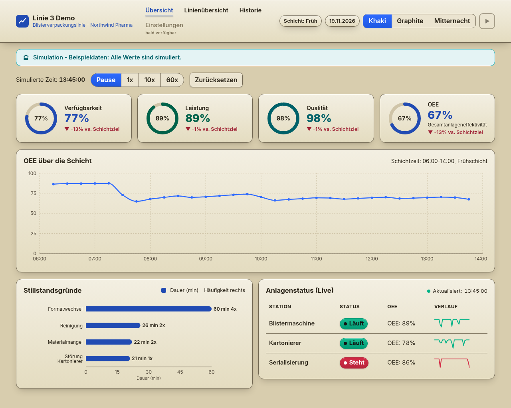
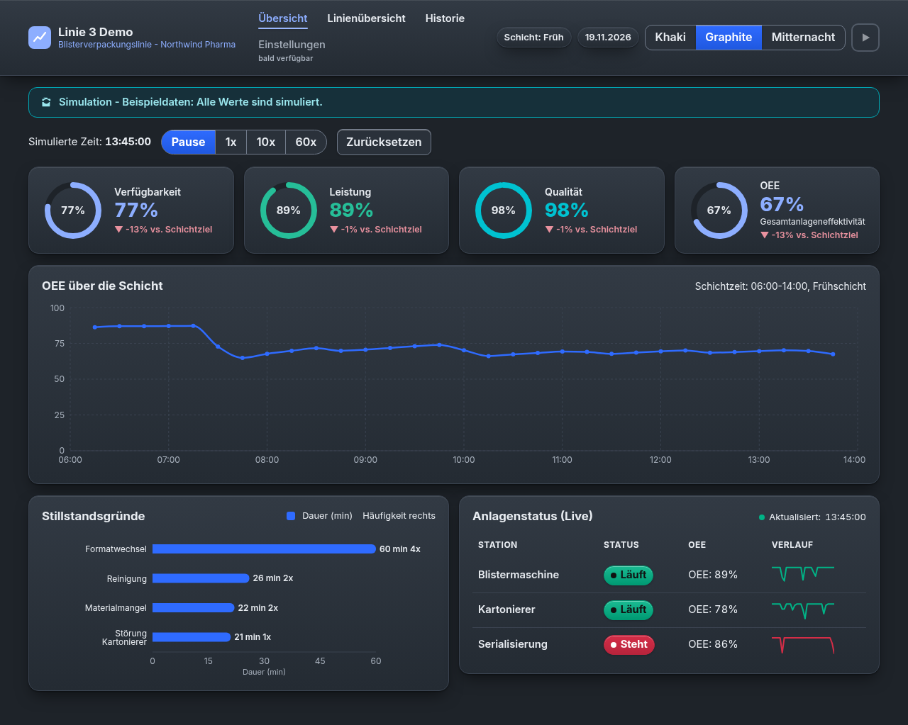
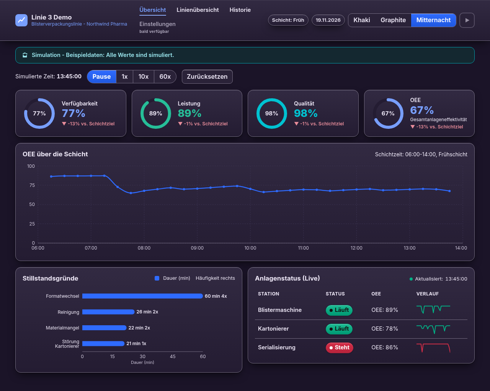

# OEE Dashboard Demo

A simulated OEE (overall equipment effectiveness) dashboard for a fictional blister packaging line: **Linie 3 Demo** at **Northwind Pharma**. The UI is in German.

**Live:** https://ali1129js.github.io/oee-dashboard-demo/

This is a simulation with made-up data. No values come from a real plant, and no real company, product, or line is represented.

Built with AI-assisted development (Vite, React, strict TypeScript, Recharts, Vitest).

## Screenshots

Desktop (1280px), one shot per gloss theme. Motion is off (the default).

**Khaki**



**Graphite**



**Mitternacht**



## What it shows

- **Übersicht:** four KPI rings (Verfügbarkeit, Leistung, Qualität, OEE) with a delta vs. the shift target (Schichtziel), OEE over the Frühschicht (06:00-14:00), stop reasons, and live plant status for Blistermaschine, Kartonierer, and Serialisierung
- **Linienübersicht:** three fictional lines side by side, with OEE, the three KPI parts, and a short status, following the simulation clock
- **Historie:** a table and chart of the last seven working days of Frühschicht results, with a way to open one shift's KPIs. The simulation clock does not rewrite those figures
- A ticking simulation clock with Pause, 1x, 10x, 60x, and reset (1x = one simulated minute per real second)
- Three gloss themes (Khaki, Graphite, Mitternacht) and an optional slow background motion, off when reduced motion is preferred

Einstellungen is still a placeholder marked "bald verfügbar".

## Run locally

```bash
npm ci
npm run dev        # http://localhost:5175
npm test           # leak guard, then Vitest
npm run typecheck
npm run build      # leak guard, then typecheck and Vite build
npm run shots      # headless Chrome screenshots of the three themes into docs/
```

See [docs/LERNEN.md](docs/LERNEN.md) for a short walk-through of the ideas used in the code.

## Deploying

`.github/workflows/deploy.yml` runs lint, typecheck, tests and build on every push and pull request, and deploys `dist/` to GitHub Pages when `main` or `master` changes (Pages source: GitHub Actions).

Live site: https://ali1129js.github.io/oee-dashboard-demo/
